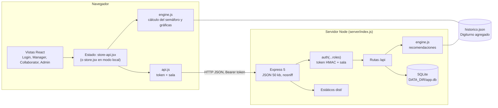

# Arquitectura

## Visión general

Aplicación de un solo servicio: un servidor Node (Express 5) que expone la API REST bajo `/api` y, si existe la carpeta `dist/`, sirve también el frontend compilado. El estado vive en SQLite (`node:sqlite`). El motor analítico (`src/engine.js`) es un módulo ES que importan tanto el navegador como el servidor, de modo que el cliente no puede falsear una recomendación: el servidor la recalcula con el mismo código.

El frontend funciona en dos modos, que se eligen al arrancar consultando `GET /api/health`:

| Modo | Cuándo | Estado | Proveedor React |
|---|---|---|---|
| API | `/api/health` responde `ok` con `db` | En el servidor (SQLite), sincronizado por sondeo cada 1,2 s | `ApiProvider` (`src/store-api.jsx`) |
| Local | No hay servidor (p. ej. sitio estático de Vercel) | En memoria del navegador, se pierde al recargar | `AppProvider` (`src/store.jsx`) |

Ambos proveedores exponen el mismo contexto (`Ctx`), por lo que las vistas no distinguen el modo.

## Componentes



Responsabilidades:

| Pieza | Archivo | Responsabilidad |
|---|---|---|
| Servidor | `server/index.js` | Rutas, base de datos, autenticación, salas, avance de la verificación por tiempo |
| Motor | `src/engine.js` | Demanda, capacidad, Erlang C, cola fluida, semáforo, donante, escenarios |
| Datos | `src/data/historico.json` | Agregados por oficina y hora; parámetros calibrados (`mu`, `kappa`) |
| Estado en navegador | `src/store-api.jsx`, `src/store.jsx` | Reloj simulado, sondeo, métricas derivadas por oficina |
| Cliente HTTP | `src/api.js` | Token en `sessionStorage`, sala en `localStorage`, manejo de errores |
| Vistas | `src/views/*.jsx` | Interfaz por rol |

## Qué se calcula dónde

- El semáforo de las 14 oficinas se calcula en el navegador con `officeState()` a partir del estado del servidor (ausencias confirmadas, traslados aprobados, parámetros de la sala) y del reloj simulado de la sesión.
- La recomendación se calcula en el servidor (`createRecommendation`) cuando el encargado confirma una ausencia o pide otra alternativa, y se guarda en la tabla `recs`.
- Las transiciones de la verificación (Nivel 1 a 2 a 3) se calculan en el servidor al leer, sin temporizadores.

## Flujo de una petición

Ejemplo: el encargado confirma una ausencia.

```mermaid
sequenceDiagram
  participant V as Vista Manager
  participant S as store-api.jsx
  participant A as api.js
  participant X as Express
  participant M as auth("encargado")
  participant DB as SQLite
  participant E as engine.js
  V->>S: confirmAbsence()
  S->>A: post("/api/cases/current/confirm", simMin, dow)
  A->>X: POST + Authorization: Bearer token
  X->>M: verifyToken (HMAC, exp, sala)
  M->>DB: SELECT usuario; ensureRoom; rol permitido
  M-->>X: req.user, req.room
  X->>DB: advanceCase; UPDATE cases; INSERT absences; INSERT audit
  X->>E: buildRecommendation(...)
  E-->>X: donante y 3 escenarios
  X->>DB: INSERT recs (payload JSON)
  X-->>A: 200 estado completo de la sala
  A-->>S: JSON (1e9 se revive como Infinity)
  S-->>V: applyState y toasts
```

Detalles del servidor, en orden: límite de cuerpo JSON de 50 kb, cabecera `X-Content-Type-Options: nosniff`, `auth()` (token, usuario, sala, acceso activo, rol), regla de negocio (409 si el caso no está en el estado esperado), escritura, y respuesta con el estado completo (`fullState`). Cualquier ruta `/api/*` desconocida devuelve 404 JSON; cualquier otra ruta sirve `index.html` (SPA). Un error no controlado devuelve 500 con un mensaje genérico.

JSON no admite `Infinity`: el servidor sustituye los infinitos por `1e9` (`jsonSafe`) y el cliente los revive.

## Modelo de salas

Cada visitante trabaja en una sala (código de 4 a 8 caracteres `A-Z0-9`; las generadas por el servidor tienen 6 y no usan caracteres ambiguos como `I`, `O`, `0`, `1`).

| Ámbito | Datos |
|---|---|
| Comunes a todas las salas | Usuarios y contraseñas, histórico de Digiturno, motor |
| Por sala | Casos, recomendaciones, traslados, ausencias, asistencia, solicitudes de corrección, trazabilidad, parámetros, checklist de gobernanza, usuarios desactivados |

Cómo se asigna la sala:

1. `POST /api/auth/login` acepta `room` opcional. Si no viene, el servidor genera una.
2. El navegador guarda el código en `localStorage` (clave `surtigas_room`), por lo que las pestañas del mismo navegador comparten sala.
3. El token firmado incluye la sala; todas las lecturas y escrituras se filtran por ella.
4. Otro dispositivo entra a la misma sala escribiendo el mismo código.
5. Las salas sin actividad durante 24 horas se purgan (al iniciar y cada 30 minutos).

Las salas aíslan el estado de demostración; no son una frontera de seguridad: cualquiera que conozca un código y las cuentas de demostración puede entrar a esa sala. Detalle en [modelo de datos](modelo-de-datos.md).

## Seguridad

| Mecanismo | Implementación (verificada en `server/index.js`) |
|---|---|
| Contraseñas | `crypto.scryptSync(pw, salt, 32)`, sal aleatoria de 16 bytes por usuario, hash en hexadecimal; comparación con `timingSafeEqual` |
| Token | `base64url(JSON{uid, role, room, exp})` + `.` + HMAC-SHA256 en base64url; vigencia de 8 h; verificación en tiempo constante |
| Secreto | `AUTH_SECRET` o, si no existe, uno aleatorio de 32 bytes guardado en `DATA_DIR/.secret` |
| Autorización | `auth(...roles)` consulta el rol en la base de datos en cada petición (el rol del token no se usa para decidir) |
| Roles | `encargado`, `colaborador`, `admin`; 401 sin sesión, 403 sin permiso |
| Acceso por sala | El administrador puede desactivar usuarios por sala; un usuario desactivado recibe 403 al entrar y 401 con un token previo |
| Limitación de intentos | 20 intentos de ingreso por IP por minuto (ventana fija en memoria); el 21.º recibe 429. Con `trust proxy` = 1 se usa la IP real tras el proxy |
| Validaciones | Código de sala con `^[A-Z0-9]{4,8}$`; parámetros acotados con `Math.min/Math.max`; texto de corrección de 5 a 1.000 caracteres; cuerpo máximo de 50 kb; consultas SQL preparadas (los nombres de tabla interpolados salen de listas fijas) |
| Cabeceras | `X-Content-Type-Options: nosniff`; se desactiva `x-powered-by` |
| Cliente | Token en `sessionStorage` (se borra al cerrar la pestaña) |

Límites conocidos: no hay revocación de tokens antes de su vencimiento; la limitación de intentos se reinicia al reiniciar el servidor; no hay proveedor de identidad corporativo ni doble factor; las cuentas de demostración tienen una clave pública por defecto; no se configuran otras cabeceras de seguridad (CSP, HSTS) en la aplicación, la terminación TLS la hace el host.

## Decisiones de diseño y alternativas descartadas

| Decisión | Motivo | Alternativas descartadas |
|---|---|---|
| SQLite con `node:sqlite` | Cero servicios externos, un solo archivo, modo WAL, ideal para un prototipo con pocas escrituras. Se instala con Node, sin dependencias nativas | PostgreSQL o MySQL: exigen un servicio administrado y credenciales extra sin aportar valor a esta escala. Archivos JSON: sin transacciones ni consultas. `better-sqlite3`: dependencia nativa que se compila |
| Un solo servicio para web y API | Un único despliegue, sin CORS, el frontend usa rutas relativas | Frontend y API separados: más configuración, CORS y dos despliegues |
| No usar Vercel para el backend | Las funciones sin servidor tienen sistema de archivos efímero y sin proceso persistente, lo que no encaja con SQLite en archivo, el temporizado por lectura y el estado en disco. Vercel se mantiene para el sitio estático (modo local) | Reescribir la persistencia contra una base administrada solo para ese host |
| Render para la demo completa | Ejecuta el proceso Node tal cual, tiene plan gratuito y soporta disco persistente en planes de pago | Railway o Fly.io: hosts Node con disco persistente que servirían igual; se eligió Render por su plan gratuito y su Blueprint |
| Verificación por tiempo calculada al leer | Sin temporizadores ni colas en el servidor; el estado es siempre consistente con el reloj | `setTimeout` en el servidor: se pierde al reiniciar y complica las pruebas |
| Sondeo cada 1,2 s | Simple y suficiente para la demo; compatible con cualquier host | WebSockets o SSE: más complejidad sin necesidad a esta escala |
| Motor compartido en un módulo | Una sola fuente de verdad para navegador, servidor y generador del mockup | Duplicar la lógica en el backend |
| Gráficos en SVG propio | Menos dependencias y control total del estilo | Librerías de gráficos |
| Salas en lugar de multi-inquilino real | Permite varias demostraciones simultáneas sin cuentas por persona | Una base por visitante |
| Reloj simulado en el cliente | Permite recorrer el día (07:30 a 16:30) en minutos; la hora real no importa para la demo | Reloj en servidor: sesiones del mismo caso no podrían explorar horas distintas |

## Despliegue y entornos

Ver [despliegue](despliegue.md). Variables de entorno del servidor: `PORT` (3001 por defecto), `DATA_DIR` (por defecto `server/data`), `AUTH_SECRET`, `DEMO_PASSWORD`.

## Limitaciones de arquitectura

- El reloj simulado es local a cada sesión: dos pestañas pueden mostrar horas distintas. El servidor solo guarda `simMin` para rotular la trazabilidad.
- La interfaz muestra el nombre de la cuenta autenticada. El caso de la demostración pertenece siempre a Laura Mendoza (Turbaco), por lo que solo esa cuenta recibe la confirmación activa del Nivel 2; con otra cuenta de colaborador no aparece. En producción el caso lo generaría la detección automática, no un botón.
- Una sola instancia: la base SQLite y el limitador de intentos están en memoria o archivo local, sin escalado horizontal.
