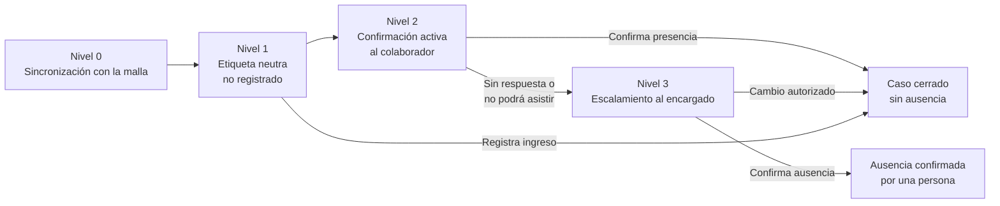

# Gobernanza y privacidad

Este documento describe los principios de uso de datos del prototipo, lo que el sistema implementa hoy y lo que falta antes de un piloto real. No es un concepto jurídico: la validación corresponde a Talento Humano y al área Jurídica de Surtigas.

## Principios

| Principio | Cómo se refleja en el prototipo |
|---|---|
| Uso exclusivamente operativo | Los datos de asistencia sirven para planificar recursos (capacidad por oficina). La pantalla del encargado y la del colaborador lo declaran: «La disponibilidad no se usa para evaluar desempeño individual» |
| Lenguaje neutro | El Nivel 1 usa la etiqueta «no registrado», nunca «ausente» |
| Decisión humana | El sistema nunca declara una ausencia por sí solo: solo el encargado la confirma (Nivel 3). Toda redistribución requiere su aprobación |
| Transparencia | El colaborador ve qué datos se registran y para qué («¿Qué datos se registran y para qué?») |
| Acceso por roles | El colaborador no puede ver usuarios, parámetros ni confirmar nada; el encargado no cambia parámetros ni usuarios; solo el administrador los gestiona (verificado con 403 en las pruebas) |
| Trazabilidad | Cada acción relevante queda en el registro de auditoría de la sala, con actor y hora |
| Minimización | Del histórico de Digiturno solo se conservan agregados; los datos personales del prototipo son los mínimos para la demostración |
| Reglas laborales definidas por quien corresponde | El tope de horas semanales de la malla es un parámetro (42 h por defecto, ajustable de 30 a 60) que debe definir Talento Humano. El prototipo no sustituye las reglas laborales reales |
| Datos de ejemplo, no reales | La plantilla de personal de la malla es ficticia (`src/data/roster.json`) |

## Verificación de ausencia en 4 niveles

El Nivel 0 contrasta con la malla de turnos: una ausencia programada por el encargado (incapacidad, permiso o vacaciones) impide abrir el caso de «no registrado» ese día. La malla del prototipo se calcula sobre una plantilla ficticia. La malla solo rige cuando el encargado la aprueba, y la aprobación queda vencida si algo cambia después.

El motor solo descuenta capacidad de las ausencias confirmadas por el encargado; las personas en verificación se muestran como «en verificación» sin restar capacidad al cálculo del semáforo.

## Ley 1581 de 2012 (protección de datos personales)

Qué implementa el prototipo en relación con esta ley:

| Elemento | Estado en el prototipo |
|---|---|
| Finalidad | Declarada al colaborador: uso operativo, no evaluación de desempeño |
| Transparencia e información | Panel «¿Qué datos se registran y para qué?» en la vista del colaborador, con mención a la Ley 1581 de 2012 |
| Canal de corrección | Implementado: `POST /api/corrections` guarda la solicitud (estado `pendiente`) y deja una entrada en la trazabilidad. El colaborador la envía desde «Solicitar corrección de un dato» |
| Acceso restringido | Control por roles verificado por pruebas; acceso a la API solo con token firmado |
| Seguridad | Contraseñas con `scrypt`, token HMAC de 8 h, limitación de intentos de ingreso |
| Aislamiento | Datos operativos separados por sala de demostración |

Qué no está implementado:

- No hay interfaz ni ruta para que Talento Humano consulte, atienda o cierre las solicitudes de corrección: hoy se almacenan.
- No hay registro de consentimiento ni autorización formal, ni política de retención más allá de la purga de salas a las 24 horas.
- No hay procedimiento de supresión por solicitud del titular.
- No se ha hecho el registro de bases de datos ante la autoridad ni evaluación de impacto.

Estos puntos corresponden a la fase previa al piloto.

## Qué datos maneja el prototipo

| Dato | Naturaleza | Dónde |
|---|---|---|
| Histórico de Digiturno | Agregados por oficina y hora de 22.611 turnos (mayo de 2026). Sin identificadores de usuarios ni de operadores; sin contratos | `src/data/historico.json` (versionado) |
| Cuentas de demostración | Cinco usuarios con nombres simulados, rol y oficina; contraseña con hash `scrypt` y sal | Tabla `users` (SQLite) |
| Casos de verificación | Nombre de la persona de la demostración, oficina, estado y plazos | Tabla `cases`, por sala |
| Plantilla de la malla | 38 colaboradores ficticios: id, nombre, oficina base, si rotan y cuenta de demostración vinculada | `src/data/roster.json` (versionado) |
| Ausencias programadas | Colaborador, día y tipo (incapacidad, permiso o vacaciones) sobre la plantilla ficticia, y la aprobación de la malla (versión, momento y quién) | Clave `kv` `malla`, por sala |
| Asistencia | Usuario, hora y vía (`puesto`) | Tabla `attendance`, por sala |
| Solicitudes de corrección | Texto libre del colaborador (hasta 1.000 caracteres) | Tabla `corrections`, por sala |
| Trazabilidad | Actor, hora y texto de cada acción | Tabla `audit`, por sala |

Qué no maneja:

- No hay datos reales de clientes ni de colaboradores: los nombres, la plantilla y la malla de turnos son simulados.
- No se almacenan datos biométricos: el «registro de ingreso» simula la autenticación; no captura huellas ni rostro.
- No se envían datos a terceros desde la aplicación (la única llamada externa del navegador es la carga de tipografías de Google Fonts).
- Los textos de corrección son libres: un usuario real podría escribir datos personales; por eso la política de retención debe definirse antes de usarlos con personas reales.

## Datos de la malla con personas reales

Hoy la malla trabaja con una plantilla ficticia. Cuando se use la nómina real conviene tener presente:

- La nómina y las ausencias programadas son datos personales de los colaboradores. No deben versionarse en un repositorio público ni quedar en `src/data/roster.json` fuera de un entorno controlado.
- Una incapacidad puede revelar información de salud. Si se registra con personas reales, Jurídica debe definir si constituye dato sensible bajo la Ley 1581 y qué tratamiento exige (finalidad, autorización y quién puede verlo).
- En el prototipo la interfaz muestra la malla solo al encargado, pero la API la entrega a cualquier rol autenticado: `GET /api/state` y `GET /api/malla` incluyen las ausencias programadas con su tipo. Antes de un piloto debe restringirse por rol y por oficina.
- El tope de horas semanales y las demás reglas laborales (jornada máxima, descansos, recargos) los define Talento Humano con Jurídica; el prototipo solo implementa un tope parametrizable.
- Los tipos de turno reales (hoy dos plantillas de ejemplo, A y B) y las reglas de ausencia los define Surtigas.

## Condiciones previas a un piloto

1. Validación de Talento Humano de la política de uso de los datos de asistencia.
2. Validación del área Jurídica del alcance y la finalidad operativa.
3. Cumplimiento de la Ley 1581 de 2012: base legal o autorización, aviso de privacidad, canal de corrección operativo con responsable, política de retención y registro de bases cuando corresponda.
4. Comunicación a los colaboradores: qué se registra, para qué y cómo corregirlo.
5. Identidad corporativa en lugar de cuentas locales (ver [hoja de ruta](hoja-de-ruta.md)).
6. Persistencia con respaldos y control de acceso a la base de datos.
7. Definir quién puede ser «encargado» y quién es el responsable del tratamiento de datos.
8. Prueba con un grupo reducido en una oficina seleccionada.
9. Definir con Talento Humano las reglas laborales de la malla (tope de horas semanales, tipos de turno, descansos) y el tratamiento de las ausencias programadas, incluidas las incapacidades.

## Checklist del Administrador

La pantalla «Gobernanza y piloto» presenta las cuatro condiciones como interruptores. El avance se guarda por sala (`PUT /api/governance`) y se registra en la trazabilidad.

| Clave | Condición | Descripción en pantalla |
|---|---|---|
| `th` | Validación de Talento Humano | Política de uso de datos de asistencia revisada |
| `legal` | Validación del área Jurídica | Revisión del alcance y finalidad operativa |
| `ley` | Cumplimiento Ley 1581 de 2012 | Tratamiento de datos personales y canal de corrección |
| `comm` | Comunicación a colaboradores | Qué se registra, para qué y cómo corregirlo |

Con 0 a 3 condiciones la pantalla muestra «Piloto bloqueado»; con las 4, «Listo para iniciar el piloto». Es un indicador de gestión del proyecto: el servidor no impide el uso del prototipo según este estado.

## Roles y permisos

| Acción | Colaborador | Encargado | Administrador |
|---|---|---|---|
| Registrar ingreso y responder la confirmación | Sí | No | No |
| Solicitar corrección de datos | Sí | No | No |
| Confirmar ausencia, aprobar o rechazar redistribuciones | No | Sí | No |
| Programar ausencias en la malla, cambiar la rotación y aprobar la malla | No | Sí | No |
| Cambiar parámetros (incluido el tope de horas semanales), gobernanza y usuarios | No | No | Sí |
| Ver el estado de la sala y la trazabilidad | Sí | Sí | Sí |
| Iniciar o reiniciar la demostración | Sí | Sí | Sí |

El estado de la sala (incluida la trazabilidad y la malla con sus ausencias programadas) es legible por cualquier rol autenticado; la interfaz muestra la trazabilidad solo al encargado, pero la API la incluye en `GET /api/state` para todos. Antes de un piloto debería restringirse la respuesta por rol.
