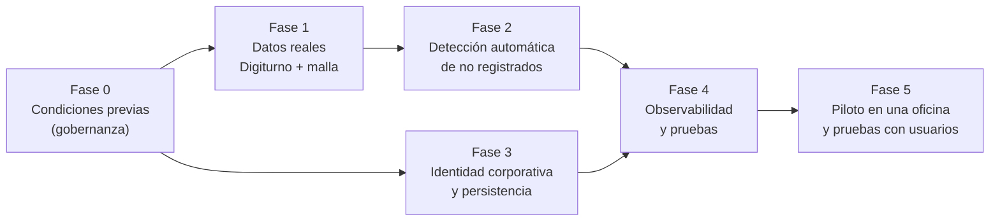

# Hoja de ruta hacia un piloto real

Punto de partida: prototipo funcional (Fase 2) con histórico agregado, cuentas de demostración y disparo manual de «persona no registrada». Este documento prioriza lo que falta para operar en una oficina real. Las prioridades son una propuesta del equipo; las fechas y los responsables dependen de Surtigas.

## Brechas actuales

| Brecha | Estado en el prototipo |
|---|---|
| Integración con Digiturno | No hay conexión en vivo; se usa `historico.json` (mayo de 2026) |
| Detección de «no registrados» | Manual: botón de demostración (`POST /api/demo/trigger`) con una persona fija |
| Malla de turnos | Simulada; no se lee la malla real |
| Identidad | Cuentas locales con clave de demostración; sin proveedor corporativo |
| Persistencia | SQLite en un solo archivo; en Render gratuito se pierde al reiniciar |
| Observabilidad | Solo `console.log`/`console.error` y `/api/health` |
| Corrección de datos (Ley 1581) | Se almacenan las solicitudes; no hay bandeja de atención |
| Pruebas | 42 pruebas de API; sin pruebas del motor ni de interfaz |
| Validación con usuarios | No realizada |

## Prioridades

| # | Iniciativa | Prioridad | Depende de | Resultado esperado |
|---|---|---|---|---|
| 0 | Condiciones de gobernanza: validación de Talento Humano y Jurídica, Ley 1581, comunicación a colaboradores | Crítica (bloquea el piloto) | Surtigas | Checklist del Administrador completo (4/4) |
| 1 | Integración con Digiturno | Alta | Acceso a la API o exportación programada | Demanda y espera actualizadas, no solo mayo de 2026 |
| 2 | Detección automática de no registrados | Alta | Malla real y registro de asistencia | Cruce malla contra asistencia que dispara el Nivel 1 sin botón |
| 3 | Identidad corporativa | Alta | TI de Surtigas | Ingreso con cuenta corporativa; roles asignados por el administrador |
| 4 | Persistencia y respaldos | Alta | Host con disco o base administrada | Datos que sobreviven a reinicios, con respaldos |
| 5 | Observabilidad | Media | 4 | Registros estructurados, métricas, alertas |
| 6 | Pruebas con usuarios | Alta, en paralelo con 1 a 4 | Grupo piloto | Retroalimentación de encargados y colaboradores |
| 7 | Mejoras del motor | Media | 1 | Mayor exactitud con más historia y variabilidad |
| 8 | Bandeja de correcciones (Ley 1581) | Media | 0 | Talento Humano atiende y cierra solicitudes |

## Detalle

### 1. Integración con Digiturno

- Definir el mecanismo: API de Digiturno, exportación programada o consulta a la base. Hoy no se conoce; hay que confirmarlo con Surtigas.
- Reutilizar el formato agregado de `historico.json` (por oficina y hora) para no tocar el motor: el integrador solo escribe los agregados. Mantener la regla de no versionar datos personales.
- Recalibrar `mu` y `kappa` con ventanas más largas (varios meses) y revisar el error medio de 7,6 min.
- Añadir demanda del día en curso para que el semáforo use llegadas reales, no solo el promedio.

### 2. Detección automática de no registrados

- Fuente de la malla: sistema o archivo de Recursos Humanos (hoy en Excel).
- Fuente de asistencia: el registro de ingreso desde el puesto (ya existe `POST /api/attendance/checkin`).
- Regla: pasado un margen configurable desde el inicio del turno sin registro, crear el caso en Nivel 1 (hoy `demo/trigger`). Mantener los niveles 2 y 3 y la regla de que solo el encargado confirma.
- Generalizar el caso: hoy la persona de la demostración está fija en el servidor (`DEMO_PERSON`).

### 3. Identidad corporativa

- Sustituir la tabla `users` por un proveedor de identidad (por ejemplo, OpenID Connect corporativo) y mapear grupos a roles.
- Mantener el control por rol en `auth(...roles)`; retirar las cuentas y la clave de demostración.
- Considerar vencimiento y revocación de sesiones y doble factor.
- Reemplazar el caso de demostración fijo (Laura Mendoza, Turbaco) por casos detectados automáticamente a partir de la malla y la asistencia.

### 4. Persistencia

- Corto plazo: disco persistente en Render (plan de pago) o Docker con volumen, con `AUTH_SECRET` fijo.
- Medio plazo: base administrada (PostgreSQL) si hay varias instancias; el acceso a datos está concentrado en `server/index.js`.
- Respaldos programados y política de retención alineada con la Ley 1581.
- Migraciones versionadas (hoy solo `CREATE TABLE IF NOT EXISTS` y una migración puntual).

### 5. Observabilidad

- Registros estructurados con identificador de petición y sala.
- Métricas: latencia, errores, casos abiertos, recomendaciones aprobadas y rechazadas.
- Alertas ante caídas (`/api/health` ya existe).
- Auditoría inmutable y exportable del registro de trazabilidad.

### 6. Pruebas con usuarios

- Sesiones con encargados de oficina: leer el semáforo, entender la recomendación, decidir.
- Sesiones con colaboradores: claridad del aviso del Nivel 2 y del texto de privacidad.
- Medir: tiempo hasta decidir, aciertos de las recomendaciones, confianza percibida y percepción de vigilancia.
- Piloto controlado en una oficina seleccionada, con criterios de salida acordados.

### 7. Mejoras del motor

- Pruebas unitarias del motor con casos de referencia.
- Revisar la implementación de Erlang C para servidores no enteros (ver [motor analítico](motor-analitico.md#limitaciones)).
- Medir el rendimiento real del apoyo virtual (hoy una constante de 0,6).
- Modelar abandono y variabilidad entre días; considerar optimización conjunta de varios traslados.

## Riesgos

| Riesgo | Mitigación |
|---|---|
| Percepción de vigilancia por parte de los colaboradores | Comunicación previa, lenguaje neutro, decisión humana y uso exclusivamente operativo |
| Datos de Digiturno de baja calidad o con cambios de formato | Validación al cargar y comparación con el histórico |
| Recomendaciones que el encargado no considera útiles | Mostrar siempre el motivo y los escenarios; registrar rechazos y analizarlos |
| Déficit estructural de capacidad en horas pico | La redistribución no crea capacidad: acompañar con planificación de personal (ver [hallazgos](hallazgos-datos.md)) |
| Dependencia de un solo proceso y un solo archivo SQLite | Persistencia y respaldos (iniciativa 4) |
