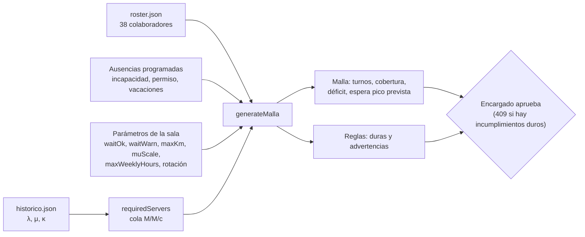
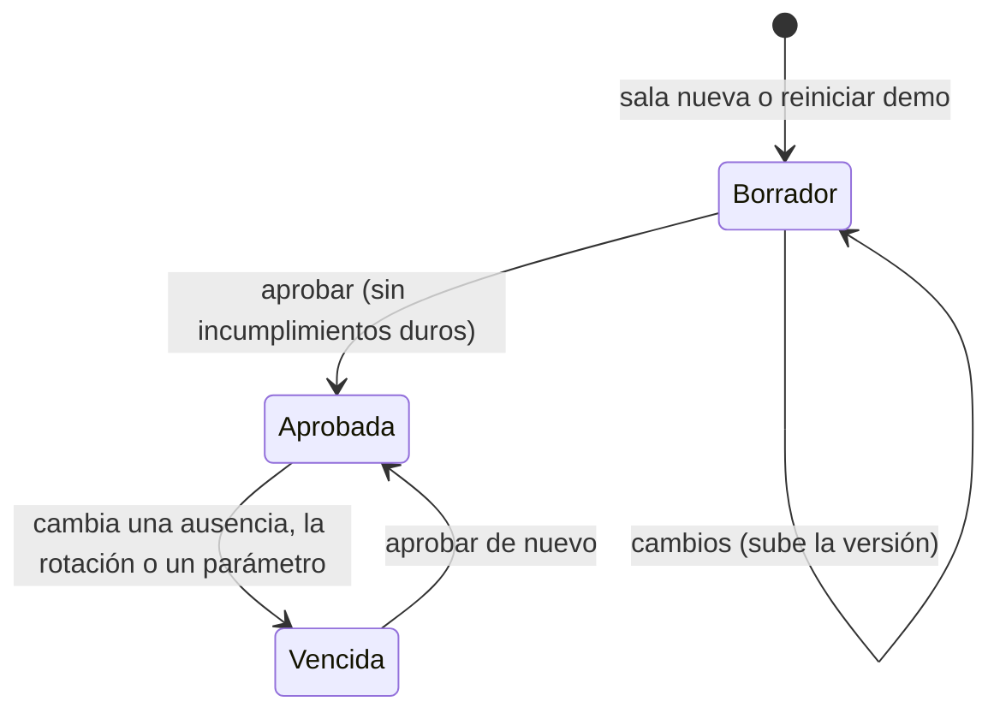

# Malla de turnos

Implementada en `src/malla.js` (sin dependencias salvo `src/engine.js` y `src/data/roster.json`). La usan el navegador (vista «Malla de turnos» y semana del colaborador) y el servidor (validación al aprobar y Nivel 0 de la verificación). Las fórmulas se escriben en texto plano.

## Propósito

Generar la programación semanal (lunes a viernes) que cubre la demanda prevista de cada oficina: quién trabaja cada día, en qué turno, con qué almuerzo escalonado y, para el personal flexible, en qué oficina. Comparte el modelo de colas del [motor analítico](motor-analitico.md): la misma demanda `λ`, la misma tasa de servicio `μ` y la misma disponibilidad `κ`. El sistema propone y valida; la malla solo rige cuando el encargado la aprueba.

Es una «semana tipo»: no tiene fechas de calendario, y se recalcula cada vez que cambia una ausencia programada, la rotación o los parámetros.

## Modelo



### Plantilla de personal

`src/data/roster.json`, marcada en el propio archivo como ficticia. Cada colaborador tiene `id`, `name`, `home` (oficina base, un id de oficina), `flex` y `username` (cuenta de demostración vinculada o `null`).

| Dato | Valor |
|---|---|
| Colaboradores | 38 |
| De planta (`flex: false`) | 31, siempre en su oficina base |
| Flexibles (`flex: true`) | 7: 3 con base en Cartagena, 2 en Montería y 2 en Sincelejo |
| Con cuenta de demostración | 3: Jorge Pineda, Ana Támara y Laura Mendoza |

### Turnos

| Turno | Presencia | Almuerzo | Horas efectivas |
|---|---|---|---|
| A | 07:30 a 16:30 | 12:00 a 13:00 | 8 |
| B | 07:30 a 16:30 | 13:00 a 14:00 | 8 |

Cada día trabajado suma 8 horas (`SHIFT_HOURS`). Una ausencia programada suma 0.

### Requerido, cobertura y déficit

Las franjas son las del histórico: 7 a 16 (la franja 7 es la media hora 07:30 a 08:00).

```
requerido(oficina, día, franja) = menor c en 1..25 tal que
                                  Wq(c·κ, λ, μ) <= waitOk        (0 si λ = 0; 25 si ninguno basta)
cobertura(franja) = (n.º en turno A que trabaja esa franja) + (n.º en turno B que trabaja esa franja)
déficit  = Σ_franjas [ max(0, requerido − cobertura) + 0,02 · max(0, cobertura − requerido) ]
```

`Wq` es la espera estacionaria M/M/c de `engine.js`. El exceso de personal casi no penaliza (0,02 por servidor sobrante) para que el reparto prefiera cubrir faltantes. En los resúmenes, «déficit de personal» es la suma de `max(0, requerido − cobertura)` sobre las franjas de todas las oficinas y días (la interfaz lo rotula «servidores-hora»).

La cobertura de la franja de las 16:00 cuenta como completa aunque el turno termina a las 16:30.

### Espera pico prevista

`predictWait` simula el día de 07:30 a 17:00 en pasos de 5 minutos con la cola fluida de `engine.js`, usando la cobertura programada (`c = κ · cobertura`). Devuelve la espera máxima (acotada a 180 min) y la hora a la que ocurre; solo se consideran los instantes con `λ` mayor que 0,5 llegadas por hora.

### Rotación

El personal flexible puede cambiar de oficina un día cualquiera, solo si la nueva oficina queda a `maxKm` o menos de su oficina base (distancia Haversine). Los colaboradores de planta nunca rotan. La rotación se activa o desactiva por sala.

### Reglas

| Código | Nivel | Condición |
|---|---|---|
| `horas_semanales` | Dura (`crit`) | Un colaborador supera el tope de horas semanales. Impide aprobar la malla |
| `cobertura_insuficiente` | Advertencia (`warn`) | La espera pico prevista de una oficina en un día supera `waitWarn` |
| `sin_cobertura` | Advertencia (`warn`) | Una franja sin ningún colaborador programado, con demanda prevista de al menos 3 llegadas por hora |

Las advertencias de cobertura son estructurales: indican que la red necesita más personal en esas franjas, no un error de reparto. No impiden aprobar.

Con el tope por defecto (42 h) y una semana de 5 días de 8 horas, nadie puede pasarse: el máximo posible es 40 h. La regla solo se activa si el tope se baja de 40 (con 36 h, los 38 colaboradores incumplen; es lo que comprueban las pruebas).

## Algoritmo paso a paso

`generateMalla({ absences, params, rotation, maxWeeklyHours })`:

1. Se indexan las ausencias por colaborador y día (`kind`: `incapacidad`, `permiso` o `vacaciones`).
2. Para cada día `dow` de 0 (lunes) a 4 (viernes):
   1. Se calcula `requerido` de cada oficina con `requiredServers`.
   2. Los colaboradores con ausencia ese día quedan fuera. Los de planta (y todos, si la rotación está desactivada) se asignan a su oficina base.
   3. Si la rotación está activa, cada colaborador flexible sin ausencia, en el orden de la plantilla, evalúa su oficina base y las oficinas dentro del radio `maxKm`. Para cada una calcula la ganancia: cuánto baja el déficit si se suma una persona más a la tripulación actual de esa oficina. Se queda en la base salvo que otra oficina supere su ganancia por más de 0,25.
   4. En cada oficina, con `n` personas, se prueban los `n + 1` repartos entre turno A y turno B y se elige el de menor déficit (en empate, el de menos personas en A). Las primeras `a` personas de la lista van al turno A y el resto al B.
   5. Se calcula la espera pico prevista con la cobertura resultante.
3. Se suman las horas semanales de cada colaborador (8 por día trabajado).
4. Se generan las reglas: `horas_semanales`, `cobertura_insuficiente` y `sin_cobertura`.
5. Se calcula el resumen.

El resultado es determinista: los mismos datos producen la misma malla (lo comprueba una prueba).

### Resumen (`summary`)

| Campo | Significado |
|---|---|
| `coveragePct` | Porcentaje de franjas con demanda cuya cobertura alcanza lo requerido |
| `deficitServers` | Déficit de personal total, redondeado |
| `worst` | Oficina y día con la mayor espera pico prevista |
| `operators`, `shiftsScheduled` | Colaboradores y turnos programados en la semana |
| `maxHours` | Mayor número de horas semanales de un colaborador |
| `absences` | Ausencias programadas |
| `visitingShifts` | Turnos de personal flexible en una oficina distinta a su base |
| `hardViolations` | Incumplimientos duros |

Referencia con los parámetros por defecto, sin ausencias y con la plantilla ficticia: 71 % de cobertura, 190 turnos, 12 turnos de rotación, ningún incumplimiento duro, 48 advertencias (40 de espera pico y 8 de franjas sin cobertura) y la peor espera en Cartagena el lunes. Estas cifras describen la plantilla de ejemplo, no la situación real de Surtigas.

## Parámetros

Se guardan por sala (ver [modelo de datos](modelo-de-datos.md)).

| Parámetro | Defecto | Efecto en la malla |
|---|---|---|
| `waitOk` | 20 min | Define el personal requerido por franja |
| `waitWarn` | 45 min | Umbral de la advertencia `cobertura_insuficiente` |
| `maxKm` | 60 km | Radio máximo de la rotación del personal flexible |
| `muScale` | 1,0 | Escala la tasa de servicio y, con ella, el personal requerido |
| `maxWeeklyHours` | 42 h (30 a 60 en servidor e interfaz) | Tope de horas semanales por colaborador; regla dura. Lo debe definir Talento Humano |
| `rotation` | activa | Permite al personal flexible cambiar de oficina (`PUT /api/malla/settings`) |
| `absences` | ninguna | Ausencias programadas por colaborador y día (`PUT /api/malla/absences`) |

## Aprobación y vigencia

- El encargado aprueba con «Aprobar malla» (`POST /api/malla/approve`). El servidor recalcula la malla y responde 409 si hay incumplimientos duros.
- La aprobación guarda la versión, la fecha y quién aprobó.
- Cada cambio de ausencia, de rotación o de parámetros del administrador incrementa la versión de la malla. Una aprobación de una versión anterior queda vencida (`stale`): la pantalla muestra «Vencida» y hay que aprobar de nuevo.
- «Reiniciar demo» restablece la malla (sin ausencias, rotación activa, versión 1, sin aprobar).
- El colaborador ve «Malla aprobada vN» si la aprobación está vigente y «Malla en borrador» en otro caso.



## Integración con la verificación (Nivel 0)

Antes de etiquetar a alguien como «no registrado», el sistema contrasta con la malla:

- `POST /api/demo/trigger` acepta `dow` (0 a 4, por defecto 4). Si la persona de la demostración (Laura Mendoza) tiene una ausencia programada ese día, responde 409 y no se crea el caso: no es un caso de «no registrado».
- Si no la tiene, la trazabilidad registra «Nivel 0 · Malla vN sincronizada: Laura Mendoza figura en Turno X (…) en Oficina». La pantalla «Verificación» muestra esa misma línea, con «aprobada» o «en borrador» según el estado.
- El caso de la demostración siempre se dispara el viernes (`dow` 4 en el cliente).

## Integración con el colaborador

La vista del colaborador muestra «Tu turno de hoy» (oficina, turno, ingreso, almuerzo, regreso y cierre; «visita por rotación» si trabaja fuera de su base; o la ausencia programada) y «Tu semana» con las horas. El día es el del selector del dashboard (viernes por defecto). Se busca al colaborador por el `username` de la cuenta; si el usuario no está en la plantilla, la vista dice que no tiene turnos asignados.

## Exportación

`mallaToCsv(malla, officeId)` genera un CSV con las columnas Colaborador, Oficina base, Lunes a Viernes y Horas semanales. Cada celda dice el turno y el horario, `en <oficina>` si es una visita, o `Ausente (tipo)`. En la interfaz, «Exportar CSV» descarga `malla-<id de oficina>-semana.csv` de la oficina seleccionada (incluye a quienes tienen base allí o trabajan allí algún día), con BOM UTF-8 para abrirlo en Excel.

## Límites

- La plantilla y los nombres son ficticios; no hay importación de la nómina real.
- Solo existen dos plantillas de turno (A y B) y semana de lunes a viernes. No hay sábados, festivos, turnos partidos, nocturnos ni fines de semana.
- La única regla laboral dura es el tope de horas semanales. Faltan descansos obligatorios, jornada máxima diaria, recargos, antigüedad o preferencias, que define Surtigas con Talento Humano.
- La asignación es voraz: el reparto A/B es óptimo por oficina y día, pero la rotación se decide colaborador por colaborador en el orden de la plantilla, y cada día se resuelve por separado. No equilibra la carga de trabajo ni las visitas entre colaboradores a lo largo de la semana.
- La malla no está conectada al semáforo ni al recomendador de redistribución: estos usan el personal típico del histórico y las ausencias confirmadas por el encargado. Una ausencia programada en la malla no cambia el Centro de decisión.
- El Nivel 0 solo consulta a la persona de la demostración; no hay un cruce general entre la malla y el registro de asistencia.
- La demanda es el promedio de mayo de 2026 escalado por día de la semana; no hay festivos, campañas ni eventos extraordinarios.
- Las ausencias programadas son por día completo.

## Cómo reemplazar la plantilla ficticia por la nómina real

Hoy no existe una importación; se hace editando `src/data/roster.json` (lo leen el servidor y el navegador, por lo que hay que reiniciar el servidor y recompilar la web después de cambiarlo).

1. Un objeto por colaborador, con `id` único, `name`, `home` (uno de los 14 ids de oficina: `ctg`, `mon`, `sin`, `cer`, `tur`, `mag`, `sah`, `cor`, `car`, `lor`, `mpx`, `cau`, `tol`, `plr`), `flex` y `username`.
2. `flex: true` solo para quienes puedan rotar entre oficinas según la política de Surtigas.
3. `username`: la cuenta con la que el colaborador entra, si existe. Debe coincidir con una cuenta de la tabla `users`.
4. Conservar el registro de `laura.mendoza`, porque el servidor lo busca por ese `username` para el Nivel 0 de la demostración. Retirar ese caso fijo exige cambiar el código (ver [hoja de ruta](hoja-de-ruta.md)).
5. Revisar que el personal por oficina sea coherente con el del histórico (`staff` en `historico.json`), con el que se calibró `κ`. Si la nómina real difiere mucho, recalibrar con `npm run calibrar`.
6. Los datos de la nómina son personales: no deben versionarse en un repositorio público (ver [gobernanza y privacidad](gobernanza-y-privacidad.md)).
7. Los tipos de turno reales y las reglas laborales reales requieren cambiar `SHIFT_TYPES` y la validación en `src/malla.js`; no se configuran desde la interfaz.
8. Ejecutar `npm test` y revisar las pruebas que dependen de la plantilla: 38 colaboradores, 7 flexibles y el viernes de Laura en Turbaco. Si se cambia la plantilla, esas pruebas se deben actualizar.
