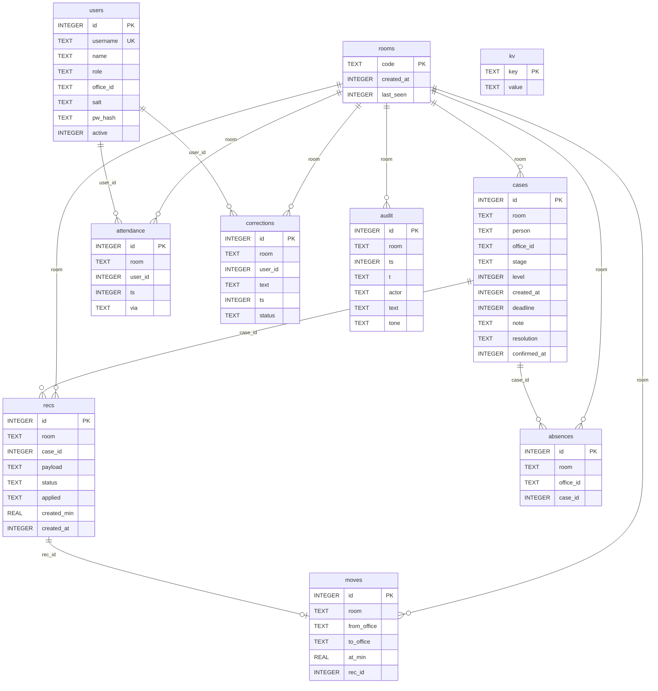
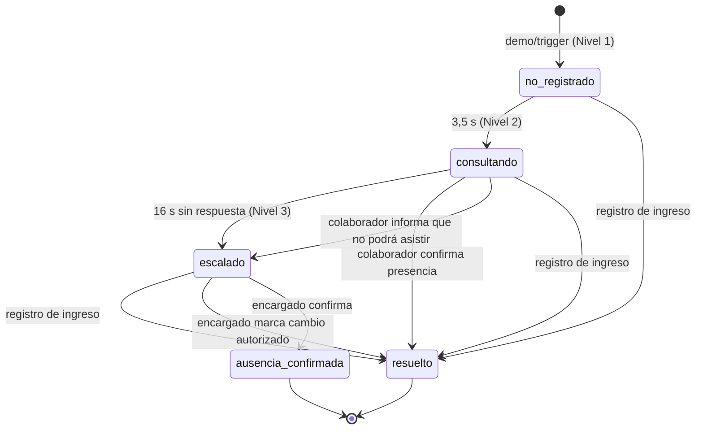
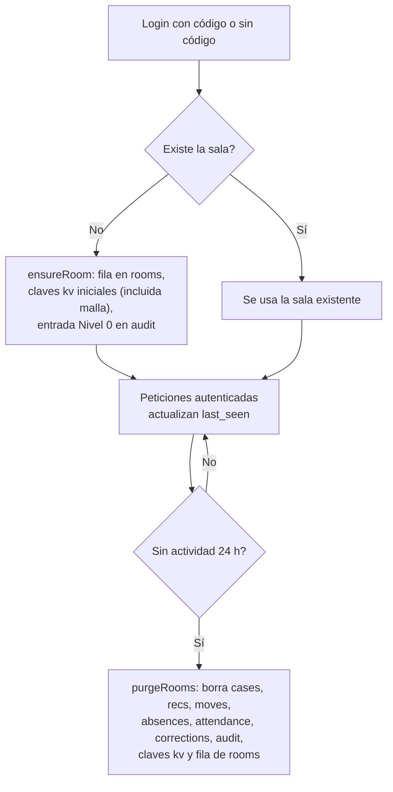

# Modelo de datos

Base SQLite en `DATA_DIR/app.db` (por defecto `server/data/app.db`), abierta con `node:sqlite` en modo WAL. Junto al archivo se guarda `DATA_DIR/.secret` si no se define `AUTH_SECRET`. El esquema se crea al iniciar (`CREATE TABLE IF NOT EXISTS`).

No hay claves foráneas declaradas: las relaciones son lógicas y las mantiene el código del servidor.

## Diagrama entidad-relación



`kv` no aparece relacionada porque su clave lleva el código de sala como prefijo (`<SALA>:<nombre>`).

## Tablas

### users (común a todas las salas)

| Columna | Tipo | Notas |
|---|---|---|
| `id` | INTEGER PK autoincremental | |
| `username` | TEXT único, no nulo | Minúsculas, p. ej. `marta.rios` |
| `name` | TEXT no nulo | Nombre visible (simulado) |
| `role` | TEXT no nulo | `CHECK` en `encargado`, `colaborador`, `admin` |
| `office_id` | TEXT | Id de oficina (p. ej. `tur`); nulo para encargado y administrador |
| `salt` | TEXT no nulo | 16 bytes aleatorios en hexadecimal |
| `pw_hash` | TEXT no nulo | `scrypt` de 32 bytes en hexadecimal |
| `active` | INTEGER, 1 por defecto | Activación global; la activación por sala está en `kv` |

La tabla se llena solo si está vacía (`seedUsers`): `marta.rios`, `laura.mendoza` (Turbaco), `luis.herrera`, `jorge.pineda` (Cartagena) y `ana.tamara` (Montería).

### rooms

| Columna | Tipo | Notas |
|---|---|---|
| `code` | TEXT PK | 4 a 8 caracteres `A-Z0-9` |
| `created_at` | INTEGER | ms epoch |
| `last_seen` | INTEGER | Se actualiza en cada petición autenticada; base de la purga |

### kv

| Columna | Tipo | Notas |
|---|---|---|
| `key` | TEXT PK | `<SALA>:<nombre>` |
| `value` | TEXT | JSON |

Claves por sala:

| Clave | Valor | Se crea |
|---|---|---|
| `governance` | `{ th, legal, ley, comm }` booleanos | Al crear la sala (todo en `false`) |
| `params` | `{ waitOk, waitWarn, maxKm, muScale, maxWeeklyHours }` | Al crear la sala, con los valores por defecto (20, 45, 60, 1 y 42 h semanales) |
| `malla` | `{ absences, rotation, version, approved }` (ver abajo) | Al crear la sala: sin ausencias, rotación activa, versión 1, sin aprobar |
| `lauraIn` | booleano | Al crear la sala (`false`) |
| `inactive` | arreglo de ids de usuario desactivados en la sala | Al crear la sala (`[]`) |
| `simMin` | minutos simulados (número) | Al disparar la demo o confirmar una ausencia; si no existe se asume 785 (13:05) |

#### Clave `malla`

Estado de la malla de turnos de la sala. La malla en sí (turnos, cobertura, reglas) no se guarda: se calcula con `generateMalla` a partir de la plantilla, de este estado y de los parámetros.

```json
{
  "absences": [ { "op": "op26", "dow": 4, "kind": "incapacidad" } ],
  "rotation": true,
  "version": 3,
  "approved": { "version": 2, "at": 1760000000000, "by": "Marta Ríos" }
}
```

| Campo | Descripción |
|---|---|
| `absences` | Ausencias programadas: id del colaborador (`roster.json`), día (0 lunes a 4 viernes) y tipo (`incapacidad`, `permiso`, `vacaciones`). Una por colaborador y día |
| `rotation` | Permite que el personal flexible cambie de oficina |
| `version` | Empieza en 1 y sube con cada cambio de ausencias, de rotación o de parámetros del administrador |
| `approved` | `null` o la versión aprobada, el momento (ms epoch) y quién aprobó. La API añade `stale` al servirlo: verdadero si `approved.version` difiere de `version` |

`POST /api/demo/reset` devuelve esta clave a su valor inicial. Ver [malla de turnos](malla-de-turnos.md#aprobación-y-vigencia).

### cases

Casos de verificación de asistencia. El caso vigente es el de mayor `id` de la sala.

| Columna | Tipo | Notas |
|---|---|---|
| `id` | INTEGER PK | |
| `room` | TEXT no nulo, `'DEMO'` por defecto | |
| `person` | TEXT no nulo | Nombre de la persona verificada |
| `office_id` | TEXT no nulo | Oficina |
| `stage` | TEXT no nulo | `no_registrado`, `consultando`, `escalado`, `ausencia_confirmada`, `resuelto` |
| `level` | INTEGER no nulo | 1 a 3 |
| `created_at` | INTEGER no nulo | ms epoch; base de los plazos |
| `deadline` | INTEGER | ms epoch del fin de la ventana del Nivel 2 |
| `note` | TEXT | P. ej. `Sin respuesta del colaborador` |
| `resolution` | TEXT | `registro_tardio`, `confirmado_colaborador`, `reasignacion` |
| `confirmed_at` | INTEGER | Minuto simulado de la confirmación de ausencia |

Ciclo de vida del caso:



### recs

Recomendaciones del motor.

| Columna | Tipo | Notas |
|---|---|---|
| `id` | INTEGER PK | |
| `room` | TEXT | |
| `case_id` | INTEGER no nulo | Caso de origen |
| `payload` | TEXT no nulo | JSON de `buildRecommendation` (donante, km, escenarios, etc.) |
| `status` | TEXT, `pendiente` por defecto | `pendiente`, `aprobada`, `rechazada` |
| `applied` | TEXT | `move` o `virtual` al aprobar |
| `created_min` | REAL no nulo | Minuto simulado de creación |
| `created_at` | INTEGER no nulo | ms epoch |

Los donantes con recomendaciones `rechazada` del mismo caso se excluyen en el siguiente análisis.

### moves

Traslados temporales aprobados (el apoyo virtual no genera fila).

| Columna | Tipo | Notas |
|---|---|---|
| `id` | INTEGER PK | |
| `room` | TEXT | |
| `from_office`, `to_office` | TEXT no nulos | Oficina donante y receptora |
| `at_min` | REAL | Minuto simulado |
| `rec_id` | INTEGER | Recomendación que lo originó |

### absences

Ausencias confirmadas por el encargado: `id`, `room`, `office_id` (no nulo), `case_id`. El personal vigente de una oficina es el típico menos sus ausencias confirmadas más/menos sus traslados.

### attendance

Registros de ingreso desde el puesto: `id`, `room`, `user_id`, `ts` (ms epoch), `via` (siempre `puesto`).

### corrections

Solicitudes de corrección de datos (Ley 1581): `id`, `room`, `user_id`, `text`, `ts`, `status` (`pendiente` por defecto). Hoy solo se insertan; no hay ruta de lectura ni de resolución.

### audit

Trazabilidad: `id`, `room`, `ts` (ms epoch), `t` (hora mostrada: hora simulada si se conoce, si no la del servidor `HH:MM`), `actor` (Sistema, Motor, Encargada, Administrador o nombre del colaborador), `text`, `tone` (`ok`, `warn` o nulo). La API devuelve las 60 más recientes.

## Índices

`idx_cases_room`, `idx_audit_room` e `idx_recs_room` (sobre la columna `room`). `users.username` y `rooms.code` tienen índice por restricción de unicidad o clave primaria.

## Migración

Al iniciar, para las tablas `cases`, `recs`, `moves`, `absences`, `attendance`, `corrections` y `audit`, si falta la columna `room` se agrega con valor por defecto `'DEMO'`. Esto permite abrir bases creadas antes de las salas.

## Ciclo de vida de las salas



- Creación: en el ingreso o en la primera petición autenticada con un token de esa sala.
- Purga: `purgeRooms()` al iniciar el servidor y cada 30 minutos (`setInterval`, sin mantener vivo el proceso). Elimina las salas con `last_seen` anterior a 24 h.
- `POST /api/demo/reset` limpia el caso, la recomendación, los traslados, las ausencias y la trazabilidad de la sala y reinicia la malla (clave `malla`), pero conserva la sala, sus parámetros (incluido el tope de horas semanales), la gobernanza y la asistencia.
- Las pruebas automáticas crean las salas `TESTA1` y `TESTB2` y una sala aleatoria por ejecución; los parámetros y la gobernanza quedan restablecidos al terminar, y las salas se purgan por inactividad.

## Datos que no están en la base

El histórico de Digiturno no se guarda en SQLite: es un archivo JSON versionado (`src/data/historico.json`) que se empaqueta con la web y con el servidor. Se regenera con `scripts/agregar-digiturno.py` y se recalibra con `scripts/calibrar-kappa.mjs`. Ver [hallazgos de datos](hallazgos-datos.md).

La plantilla de personal de la malla tampoco está en SQLite: es `src/data/roster.json`, común a todas las salas y también empaquetada con la web y con el servidor.

| Campo de `roster.json` | Descripción |
|---|---|
| `nota` | Aviso en el propio archivo: plantilla ficticia para la demostración, a sustituir por la nómina real |
| `operators[].id` | Identificador del colaborador (`op01` a `op38`); es el que usan las ausencias programadas |
| `operators[].name` | Nombre simulado |
| `operators[].home` | Id de la oficina base (uno de los 14) |
| `operators[].flex` | `true` si puede rotar entre oficinas (7 de 38) |
| `operators[].username` | Cuenta de demostración vinculada o `null` (3 de 38) |

Cómo sustituirla por la nómina real: ver [malla de turnos](malla-de-turnos.md#cómo-reemplazar-la-plantilla-ficticia-por-la-nómina-real).
