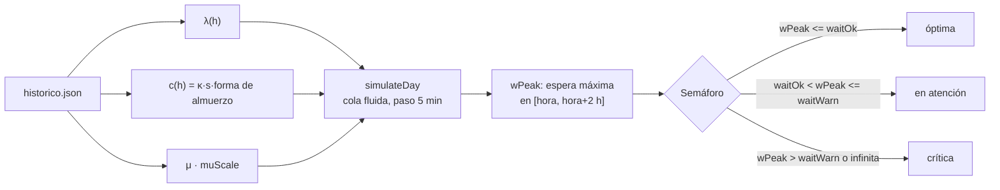
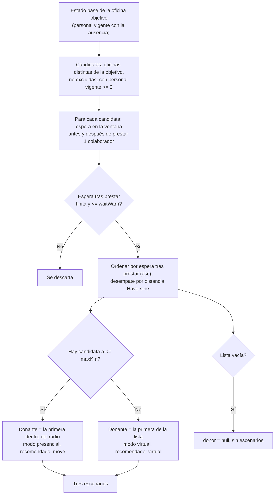

# Motor analítico

Implementado en `src/engine.js` (199 líneas, sin dependencias salvo `historico.json`). Lo usan el navegador (semáforo, gráficas), el servidor (recomendaciones) y el generador del mockup. Las ecuaciones se escriben en texto plano.

## Resumen

Para cada oficina `o`, hora `h` y personal vigente `s`:

1. Se estima la demanda `λ(h)` (llegadas por hora) desde el histórico, escalada por el día de la semana.
2. Se estima la capacidad `c(h)` (servidores efectivos) y la tasa de servicio `μ`.
3. Se simula el día (paso de 5 min) con una cola fluida que acumula backlog si `λ > c·μ`, y se suma la espera estacionaria M/M/c cuando hay holgura.
4. La espera máxima en las próximas 2 horas define el semáforo.
5. Si una oficina queda crítica tras una ausencia confirmada, se busca un donante y se comparan tres escenarios.



## Notación y parámetros

| Símbolo | Significado | Origen en el código |
|---|---|---|
| `h` | Hora del día en decimal (13,25 = 13:15) | |
| `OPEN`, `CLOSE` | 7,5 y 17: horario de atención modelado (07:30 a 17:00) | constantes |
| `i` | Franja horaria: `i = min(max(floor(h) - 7, 0), 9)`; horas 7 a 16 | `binOf` |
| `lam[i]` | Llegadas por hora, promedio por día hábil | `historico.json` |
| `dow` | Factor del día: lunes 1,31, martes 1,16, miércoles 1,05, jueves 0,91, viernes 0,64 | `HIST.dow` |
| `λ(h)` | Tasa de llegadas | `lambdaAt` |
| `cHist[i]` | Concurrencia histórica de operadores por franja | `historico.json` |
| `κ` | Disponibilidad efectiva por colaborador, calibrada por oficina | `o.kappa` |
| `s` | Personal vigente de la oficina | `effectiveStaff` |
| `μ` | Atenciones por hora por servidor | `o.mu × muScale` |
| `c(h)` | Servidores efectivos | `capacityAt` |
| `ρ` | Utilización `λ / (c·μ)` | `officeState` |
| `B` | Backlog (clientes en espera acumulados) | `simulateDay` |

## Demanda

```
λ(h) = lam[i] · f_i · dowFactor          (0 fuera de 07:30 a 17:00)
f_i  = 2 si i = 0 (franja 07:30-08:00 dura media hora), 1 en otro caso
```

La franja 7 del histórico cubre solo media hora (las oficinas abren hacia las 07:30), por eso su tasa horaria se duplica.

## Capacidad

```
cBase(o) = max( max_i cHist[i], 0.5 )
forma_i  = clamp( cHist[i] / cBase, 0.25, 1 )
lunch_i  = forma_i si i = 5 (12:00 a 13:00), 1 en otro caso
c(h)     = κ · s · lunch_i                (0 fuera de horario)
κ        = o.kappa  (o cBase / staff si no hay kappa)
```

Interpretación: la capacidad escala con el personal vigente y se reduce en la hora de almuerzo según el patrón histórico de cada oficina. El personal vigente es:

```
s = staff_típico − ausencias_confirmadas + traslados_recibidos − traslados_prestados
```

El apoyo virtual se modela como `s + 0,6` (un 60 % de un colaborador presencial).

## Régimen estable: cola M/M/c (Erlang C)

Con `a = λ / μ` (carga ofrecida en erlangs) y `n = round(c)`:

```
C(n, a) = [ a^n / n! · n/(n - a) ] / [ Σ_{k=0}^{n-1} a^k / k!  +  a^n / n! · n/(n - a) ]

Wq = C(n, a) / (c·μ − λ)      (horas)   →  × 60 para minutos
```

`waitMinutes(c, λ, μ)` devuelve:
- 0 si no hay llegadas;
- infinito si `c ≤ 0` o `λ ≥ c·μ` (cola inestable);
- en otro caso `Wq`, con `c` forzado a `a + 0,01` como mínimo para evitar divisiones degeneradas.

La longitud de fila esperada es `Lq = λ · Wq` (`queueLength`).

## Régimen saturado: cola fluida con backlog

Cuando la demanda supera la capacidad, el modelo estacionario no existe. `simulateDay` avanza con `dt = 5 min`:

```
cap(t)   = c(t) · μ
B(t+dt)  = max( 0, B(t) + (λ(t) − cap(t)) · dt )
ss(t)    = min( Wq(c, λ, μ), 45 )   si cap > 0 y 0 < λ < 0,98·cap;  si no, 0
espera(t) = (B / cap) · 60 + ss     si cap > 0
          = infinito                si cap = 0 y B > 0;  0 si B = 0
```

La espera total es el tiempo de vaciar el backlog más la espera estacionaria cuando hay holgura (acotada a 45 min). Con el backlog acumulado desde la apertura, el estado arrastra el efecto de los picos de la mañana sobre la tarde.

## Resumen por oficina y semáforo

`officeState(o, hora, s, params)` ejecuta `simulateDay` desde las 07:30 y devuelve:

| Campo | Significado |
|---|---|
| `wNow` | Espera en el instante más cercano a la hora actual |
| `wPeak`, `peakAt` | Máxima espera en la ventana `[hora, hora + 2 h]` y cuándo ocurre |
| `lamPeak` | Máxima `λ` de la ventana |
| `cNow`, `cPeak` | Capacidad ahora y en el pico |
| `rho` | `λ / cap` en el pico (9 si no hay capacidad) |
| `backlog` | Backlog ahora |

El semáforo usa la espera del pico previsto, no la actual (anticipa en vez de reaccionar):

| Estado | Regla (minutos, configurable) |
|---|---|
| Óptima | `wPeak ≤ waitOk` (20) |
| En atención | `waitOk < wPeak ≤ waitWarn` |
| Crítica | `wPeak > waitWarn` (45) o infinita |

El déficit de personal (`staffDeficit`) es el menor `k` de 0 a 8 colaboradores adicionales que lleva `wPeak` a `≤ waitWarn`; si no basta, devuelve 8.

## Calibración y validación

- `mu` por oficina coincide con 60 / atención media histórica en minutos (atenciones por hora por servidor, entre 4,7 en Cartagena y 10,25 en El Carmen de Bolívar).
- `κ` por oficina se ajustó contra la espera horaria observada (8:00 a 16:00), según `historico.json` (`calibracion.metodo`). Valores entre 0,58 (Corozal) y 1,48 (Lorica). Los valores mayores que 1 aparecen en oficinas de un solo colaborador (Magangué, Lorica, Mompox, Caucasia, Planeta Rica): el ajuste los eleva para reproducir la espera observada.
- Error medio absoluto reportado: 7,6 min (`calibracion.maeMin`) sobre una espera observada de 0 a 110 min (`rangoEsperaObservadaMin`).
- Verificación independiente: recalculando con el promedio de `dow = -1` (sin escalado por día), la espera simulada de las 14 oficinas frente a `waitObs` en las horas 8 a 16 da un error medio absoluto de aproximadamente 7,5 min sobre 126 puntos, consistente con el valor reportado.
- La pantalla del administrador «Parámetros del motor» muestra el modelo (línea) frente a la espera real (puntos) para las seis primeras oficinas.

El script de calibración no forma parte del repositorio; el resultado queda en `historico.json`.

## Algoritmo de recomendación

`buildRecommendation({ target, offices, staffOf, hour, params, exclude })`:



Pasos:

1. `base = officeState(objetivo, hora, staffOf(objetivo))`.
2. Candidatas: oficinas con `staffOf(o) ≥ 2`, distintas de la objetivo y fuera de `exclude`. Las oficinas de un solo colaborador nunca donan.
3. Para cada una se calcula `before` (con su personal) y `after` (con uno menos) y la distancia `km` (Haversine, radio terrestre de 6.371 km).
4. Se conservan solo las candidatas con `after.wPeak` finita y `≤ waitWarn` (donante con holgura real).
5. Se ordenan por `after.wPeak` ascendente y, en empate, por `km`.
6. `near` es la primera candidata con `km ≤ maxKm`. Si existe, el modo es `presencial`; si no, se toma la primera de la lista y el modo es `virtual`.
7. Si no hay candidatas, se devuelve `donor: null` con los datos base (el encargado decide, p. ej. refuerzo externo).
8. Si hay donante, se simulan tres escenarios sobre la oficina objetivo y se recomienda `move` (presencial) o `virtual`:

| Escenario | Personal simulado |
|---|---|
| `none` Sin cambios | `s` |
| `move` Traslado temporal | `s + 1` |
| `virtual` Apoyo virtual | `s + 0,6` |

Cada escenario reporta `wait` (espera en el pico), `queue` (fila esperada), `rho`, `c` y `lam`.

Rechazo: el servidor lee los donantes de las recomendaciones `rechazada` del mismo caso y los pasa en `exclude`, de modo que cada «pedir otra alternativa» considera menos candidatas.

### Ejemplo verificado

Viernes 13:05, Turbaco con una ausencia confirmada (queda con 1 colaborador), parámetros por defecto:

| Dato | Valor |
|---|---|
| Espera sin cambios | 112,7 min (crítica) |
| Donante | Cartagena, 17,5 km, presencial |
| Espera de Cartagena al prestar | de 0,4 a 1,2 min |
| Traslado | 4,1 min |
| Apoyo virtual | 22,7 min |
| Si se rechaza Cartagena | Montería, 183,5 km, modo virtual |

## Parámetros configurables (administrador)

| Parámetro | Defecto | Límite en servidor | Rango en la interfaz | Efecto |
|---|---|---|---|---|
| `waitOk` | 20 min | 1 a 60 | 5 a 40 | Umbral de «óptima» |
| `waitWarn` | 45 min | 5 a 180 | 20 a 90 (paso 5) | Umbral de «crítica»; también el máximo de espera tolerable para un donante |
| `maxKm` | 60 km | 1 a 500 | 10 a 250 (paso 10) | Por encima de este radio el motor propone apoyo virtual |
| `muScale` | 1,0 | 0,3 a 2 | 0,7 a 1,3 (paso 0,05) | Escala `μ` de todas las oficinas |
| `dow` | 4 (viernes) | | Selector Lun a Vie | Factor del día; no se guarda en el servidor |

Los parámetros se guardan por sala. Las referencias de los umbrales: espera media histórica de 37,2 min y 40,4 % de los turnos con espera mayor a 30 min.

## Limitaciones

- Demanda determinista a partir de promedios: no modela variabilidad día a día ni eventos extraordinarios.
- `λ` es el promedio de mayo de 2026 (19 días hábiles); no hay estacionalidad anual ni tendencia.
- Erlang C con servidores no enteros: `n = round(c)`. Cuando `a` supera `round(c)` por poco (p. ej. `c = 2,4`), la fórmula sobrestima el término estacionario (puede salir `C > 1`); la espera total queda acotada por `min(·, 45)`. En un barrido de 263.340 puntos (oficinas, personal, días y `muScale`) no se encontraron valores `NaN`.
- El apoyo virtual se modela con una constante (0,6 de un colaborador), sin medición real.
- Un solo servicio y una sola cola por oficina: no distingue tipos de trámite ni prioridades.
- No modela abandono ni reintentos de clientes; el abandono histórico (6,8 %) no retroalimenta la demanda.
- Un donante presta un solo colaborador a la vez; los efectos acumulados de varias redistribuciones se recalculan con el personal vigente, no se optimizan en conjunto.
- La capacidad se calibra con el personal típico (31 colaboradores sumando las 14 oficinas en `historico.json`), no con la malla real de cada día.
- La red está estructuralmente corta de capacidad por la mañana en los días de alta demanda: la redistribución no crea capacidad, la mueve. Ver [hallazgos](hallazgos-datos.md).
